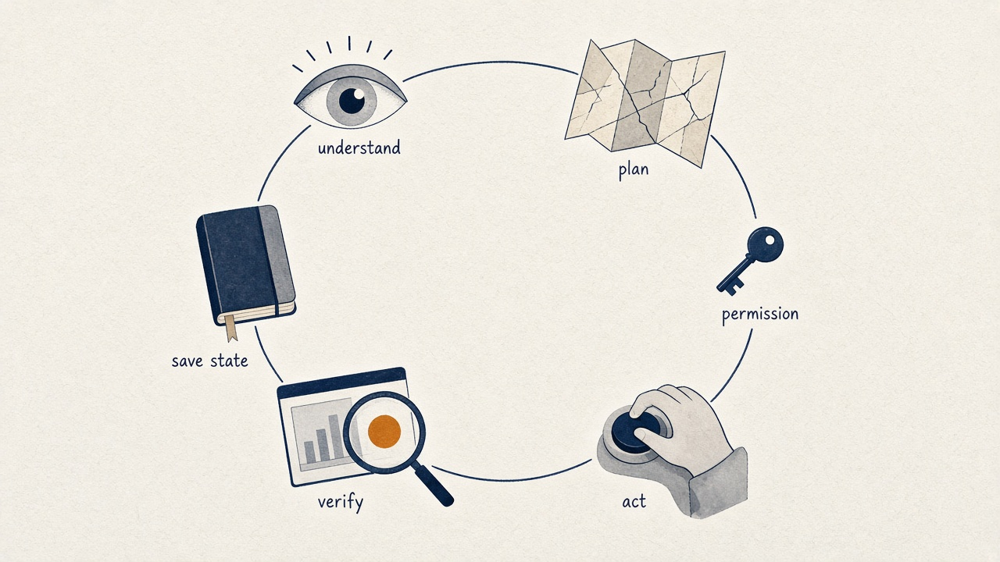
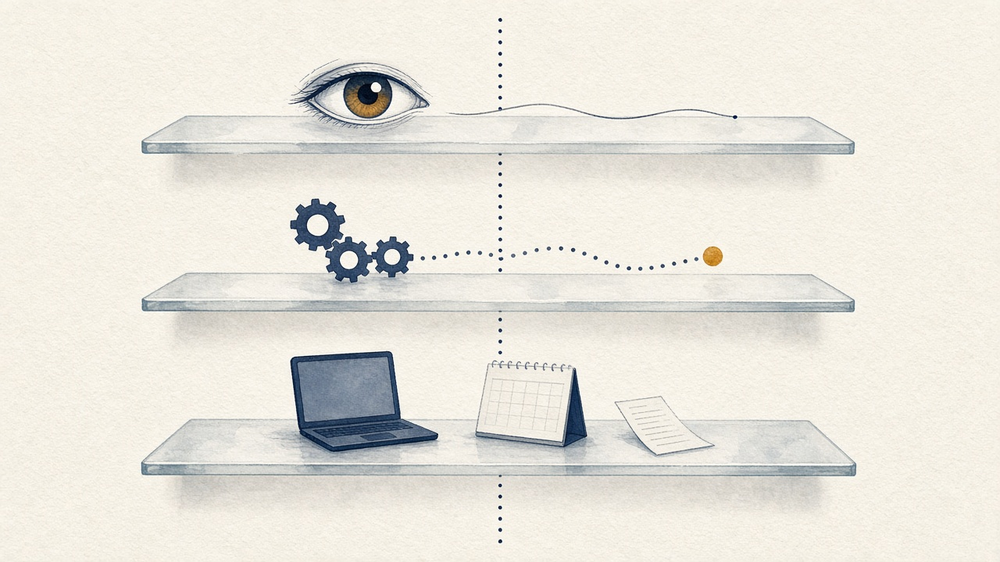

深度拆解 Muse：Meta 如何把「替你办事」做成一门生意

计划可以几秒钟写完。后面的步骤，Muse 想接过去。

AI 可以几秒钟写出一份计划。

计划里的每一步，往往还得你亲自做。查资料，对时间，切换应用，填表，整理文件，再追后续进度。

这些事单独看都不复杂。连在一起，就会不停地切走注意力。

Meta 推出的 Muse，想接住的就是这一段。

2026 年 9 月 8 日，Meta 发布个人智能体 Muse。按官方介绍，它可以连接应用、使用浏览器、处理多步骤任务，在你关闭应用后继续工作，遇到敏感操作时再请求批准。

它把一个商业问题摆到了台面上：如果 AI 能持续替人把事情往前推，人们愿不愿意交出一部分数字生活？

技术决定它能不能可靠办成。市场决定这些任务值不值得付费，以及用户为什么选 Meta。

**我的判断是：Muse 的潜力，来自模型、执行系统和产品入口叠在一起。它的长期价值，取决于两笔成本能不能一起降下来：合格交付的成本，还有用户监督的成本。**

资料截至 2026 年 10 月 8 日。

**少一次调用，省下的是整条链**

Muse 是你用到的智能体。Muse Spark 是背后的模型。

Meta 介绍 Muse Spark 1.3 时，强调的是长任务里的四件事：指令遵循、工具使用、多任务处理、出错后纠错。

他们还给了一组内部数字。在编码工作流的比较中，相对上一版，工具调用大约少 20%，token 消耗大约少 25%。

这组数字只属于这次内部比较。它可以说明效率在变，外推不成整个 Muse 的成本降幅。

聊天和智能体的差别，在于判断发生的时机。

聊天的一次回答，你马上能看出对不对。智能体要连续做决定：下一步查什么，调用哪个工具，返回结果可不可信，任务到底完成没有。

模型的价值，就落在这条执行链上。

少一次无效查询，推理开销、等待时间和出错机会可能一起减少。少一次重复操作，还可能避免对外部系统造成真实影响，比如同一笔订单被提交两次。

智能体的模型优化，要同时做到两件事：完成得更好，完成得更省。

理解、计划、权限、执行、核验、保存状态。少一次无效动作，省下的是整圈。

**办成一件事，要过三层**

公开评测和真实使用之间，还有一段距离。

Meta 的评测说明覆盖专业工作、电脑操作、自动化、软件工程和长上下文检索。说明里也标出了边界：不同测试可能使用不同执行框架；第三方模型的设置是尽量保持可比，未必是对方的最佳表现。

长上下文检索主要考察从上下文里找回信息。工具执行不在这项测试里。

读这些成绩时，可以拆成三层。

模型能理解任务。
执行系统能把任务往下推进。
最终产品能在真实账户、真实网站和异常情况里，稳定把结果交出来。

三层彼此相关，每一层都要单独成立。

上面是理解，中间是执行，下面才是真实账户里的交付。三层相关，每一层都要单独成立。

长上下文可以帮助模型保留更多信息。长期工作还要维护任务状态。某一步已经完成，预算已经改变，用户临时撤销了授权，这些变化都要准确进入下一步决策。

从工程上看，一个可靠的智能体需要这样循环：

**理解目标 → 更新计划 → 检查权限 → 执行操作 → 核验结果 → 保存状态。**

演示视频最容易盖住的，是核验结果。

页面显示“提交成功”，订单是否真的生成？日历返回成功，时间和参与者是否正确？文件已经保存，内容是否符合最初要求？

**用户买的是最后的结果。工具调用成功，只说明某一步走完了。**

屏幕上的打勾，只说明某一步走完了。用户买的是最后的结果。

任务越长，这个差别越大。

做一个纯粹的数学示例。十个步骤各自有 95% 的成功率，并且彼此独立，全部成功的概率大约只有 60%。

真实任务比这个例子更纠缠，步骤之间也不会彼此独立。它只说明一件事：单步表现不错，整件事仍可能不稳。

长任务因此还依赖检查、重试和恢复。

订单提交后网络中断，不能立刻再下一单，得先确认第一次操作的结果。跨多个应用执行时，后面一步失败，前面的修改也未必能统一撤销。

这些是智能体必须处理的系统问题。公开演示的范围，覆盖不了所有场景。它能帮助判断的是：工程壁垒会积累在哪里。

**系统得先假设模型会犯错**

Muse 的另一项关键设计，是把执行和权限分开。

按 Meta 的技术说明，工作在专属云虚拟机的隔离环境里执行，凭证由独立服务管理，连接器操作和网络请求交给 Sentinel 审核。

模型提出操作请求。审核系统决定允许、拒绝，或请用户确认。

**这套架构默认一件事：模型会犯错。**

模型在隔离环境里提出操作。审核决定放行、拒绝，或者摇铃请你确认。

智能体读取网页、邮件或文件时，接触的是外部内容。恶意内容可能诱导它偏离任务。只靠模型判断哪段文字可信，保障不够。系统还要限制它能读取什么、能把信息发到哪里、能执行哪些操作。

隔离也有清楚的边界。

Meta 表示，为了支持、安全或运营服务，公司在需要时仍可以访问数据。旨在进一步阻止服务提供方访问虚拟机数据的 Confidential VM，在发布说明里属于后续计划。

这个边界，会直接影响用户愿意交出多少信息。

智能体越了解用户，复杂任务通常越好做。信息越敏感，授权门槛越高。技术能力和信任因此绑在一起。

记忆也是同一类问题。

产品设计团队介绍，Muse 支持持续记忆、后台目标跟进和活动记录，用户可以查看、编辑记忆内容。

持久记忆能减少重复解释。记忆质量取决于信息有没有及时更新。

一个月前的出行预算，今天未必适用。一次临时偏好，也不该自动变成长期规则。长期记忆需要保留来源、时间和适用范围，新旧信息冲突时需要重新确认。

一个月前的记录，今天未必还适用。新旧信息冲突时，要停下来重新确认。

否则，过期背景会被带进越来越多的任务。

把模型、状态、权限和记忆放在一起，Muse 的技术竞争点就清楚了：它要在持续工作中，同时看清任务，也看清授权停在哪里。

**大入口解决的是“被人知道”**

接下来是市场。

Meta 的分发基础很强。2026 年第二季度财报披露，应用家族在当年 6 月的平均每日活跃人数为 36 亿。

36 亿是整个应用生态的日活。这个口径到不了 Muse 的用户规模。

入口大，试用成本可以更低。Meta 可以在用户已经熟悉的交流场景里介绍智能体。

从试用到留下，中间还有一条长链：

1. 知道这个产品
2. 愿意连接账户
3. 交出第一个任务
4. 认可交付结果
5. 再逐步扩大授权

任何一步断掉，流量都可能只换成一次短暂体验。

入口可以很大。从知道，到连接账户，到交出任务，再到持续委托，每一道门都会少一批人。

看 Muse 的增长，下载量只说明有人来过。更接近产品价值的，是三组比例：连接账户的比例，完成首个任务的比例，以及几周之后仍在委托任务的比例。

Google 和 Microsoft 也有大型入口，门开在不同的地方。对照各家已经公布的路线：

**Meta Muse**
从个人沟通场景和小企业工具连接进入。日常事务和经营需求，都可能养成使用习惯。

**Google Gemini Spark**
公布了专属云虚拟机、后台任务，以及 Google 工具的整合路线。邮件、搜索，是另一类任务入口。依据为 2026 年 Google I/O 的官方表态。

**Microsoft Autopilot**
站在企业身份和工作空间上，场景包括 Teams、Outlook。2026 年 9 月 25 日的发布说明里，它仍处于扩大私测。已有的权限体系和工作背景，有助于降低组织部署门槛。

这里比较的是任务从哪扇门进来，不是给产品能力排名。

竞争会继续考验模型。越往后，也越取决于工作本来发生在哪里。

资料、沟通和权限如果已经集中在某个平台，这个平台就更容易拿到执行所需的背景。第三方连接器可以扩展范围，同时仍然需要用户授权，也需要持续维护和外部服务的兼容性。

**小企业的任务，更容易开出账单**

对 Meta 来说，小企业尤其值得争取。

9 月 29 日，Meta 推出 Muse for Small Business，增加经营相关能力和连接器，涉及 Shopify、Canva、Slack，以及 Facebook、Instagram 商业账户。

个人用户的任务常常是散的。今天安排出行，过几周再整理文件。小企业的任务会反复出现：每周准备内容，整理客户反馈，跟进订单，检查经营数据。

频率越稳定，效果越好衡量，付费理由也越清楚。

个人任务常常是散的。小企业的内容、客户、订单和经营记录，会按周回来。

**我更看好 Muse 先在范围明确的经营任务里建立价值。** 例如每周汇总客户问题，整理活动表现，准备下一轮内容草稿。

这类任务有输入、有交付物、有固定周期。使用前后的时间和返工量，都可以比较。

“替我经营公司”是另一类需求。里面有目标冲突、预算分配、责任判断和行业经验，已经超出工具执行本身。模型可以给出建议。真要接手，还需要更复杂的治理。

小企业市场还有一个具体难点：客户可能愿意付费，却没有精力配置复杂系统。

商家如果要花很长时间整理资料、调整连接器、设置权限，智能体省下的时间会被部署成本抵消。

Meta 的商业化能力，也要看产品能多快进入一个有效的工作流程。

**20 美元买的是办成的事**

订阅价格，提供了一个观察成本的窗口。

Meta 帮助中心列出的方案是：

Power，每月 20 美元，每周额度 5 亿 Muse tokens。
Maximum，每月 100 美元，每周额度 30 亿 Muse tokens。
免费版本同样设有使用上限。

额度标明的是 Muse tokens 的上限。它回答不了能完成多少任务，也不能直接换成模型 API 的 token。

有的任务几次调用就结束。有的任务需要长时间浏览、多轮核验和失败重试。

分析这门生意，更有意义的单位是：

**每个合格交付的成本 = 全部推理、工具和运行成本 ÷ 合格交付数量。**

失败的尝试也算在分子里。

便宜模型如果频繁重试，最终成本未必更低。更强的模型如果能一次完成复杂任务，更高的单次价格也可能更划算。

用户这边，还要加上自己的监督时间。

省下两小时，再花一小时检查和修正，实际价值就会缩水。提供方这边，后台运行、文件存储、安全审核和客户支持，都要计入成本。

散落的是消耗。扎好的那一份，才是合格交付。失败的尝试，也算在成本里。

这里有一个值得盯住的张力：用得频繁、任务又复杂的用户，往往更愿意付费，也往往消耗最多资源。

缓解它，产品需要按任务难度分配推理，复用已经完成的工作，减少重复读取和无效操作，并及时停住那些已经无法推进的循环。

这些优化，会把技术效率直接变成商业效率。

Meta 有资金支持长期投入。第二季度财报给出的 2026 年全年资本开支预期为 1300 亿至 1450 亿美元，包含融资租赁的本金支付。

这是公司整体口径。据此算不出 Muse 的专项投入，也算不出单次任务的单位成本。

资本可以支持试错和扩张。最后站住，仍然要靠稳定的单位经济。

**人不再逐项盯着的那天**

更长期的价值，可能来自智能体对任务入口的影响。

用户把“帮我找合适的商品”“准备下一周活动”交给一个智能体，产品就开始参与选择、比较和执行。谁承担这些步骤，谁就更接近用户的实际决策。

这种关系如果能够长期维持，持续积累的偏好、项目背景和已授权工作流程，会提高迁移成本。

连接账户、保存记忆，只是壁垒的起点。系统持续交出有用结果，用户才有理由留下。

商业利益也需要保持透明。

用户希望智能体依据自己的预算、偏好和目标做选择。以后如果涉及合作伙伴或推荐机制，产品需要让用户看懂相关影响。越接近真实交易，解释和审计越重要。

观察 Muse 是否正在建立一门可持续的生意，我会追踪五项指标：

**无需返工的任务完成率**
执行能力是否稳定。

**每项任务的人工干预时间**
用户是否真正节省了精力。

**单个合格结果的服务成本**
技术效率能否支撑定价。

**周期性任务的持续使用率**
产品是否进入日常工作。

**从试用到付费的转化与留存**
用户是否认可长期价值。

指标先记在这里。

Muse 的路线已经摆出来了。模型决定下一步，运行环境把操作做完，权限系统在该停的地方停住，再顺着 Meta 的入口，走进个人和小企业的日常。

后面要看一个循环能不能转起来。任务越可靠，用户越愿意继续交。结果越清楚，付费就越站得住。每次办成的成本越低，这门生意才放得大。

回到开头那份几秒钟就能写完的计划。

费人的往往不是计划本身，而是后面那些步骤：查资料，对时间，填表，改文件，再确认进度。

**哪一天，这些步骤不用你逐项盯着，Muse 才算把「替你办事」做成了一门生意。**

交付足够稳定，权限足够清楚。一件事被办完，下一次你还愿意交给它。
